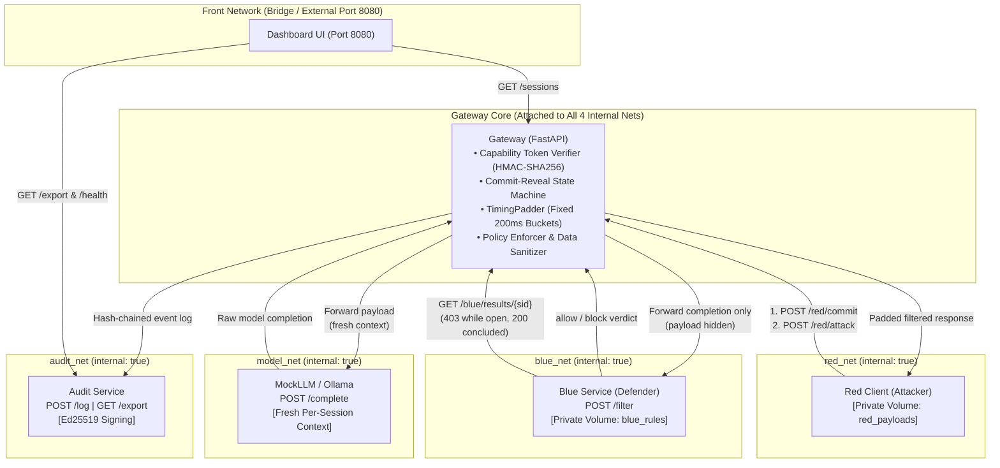
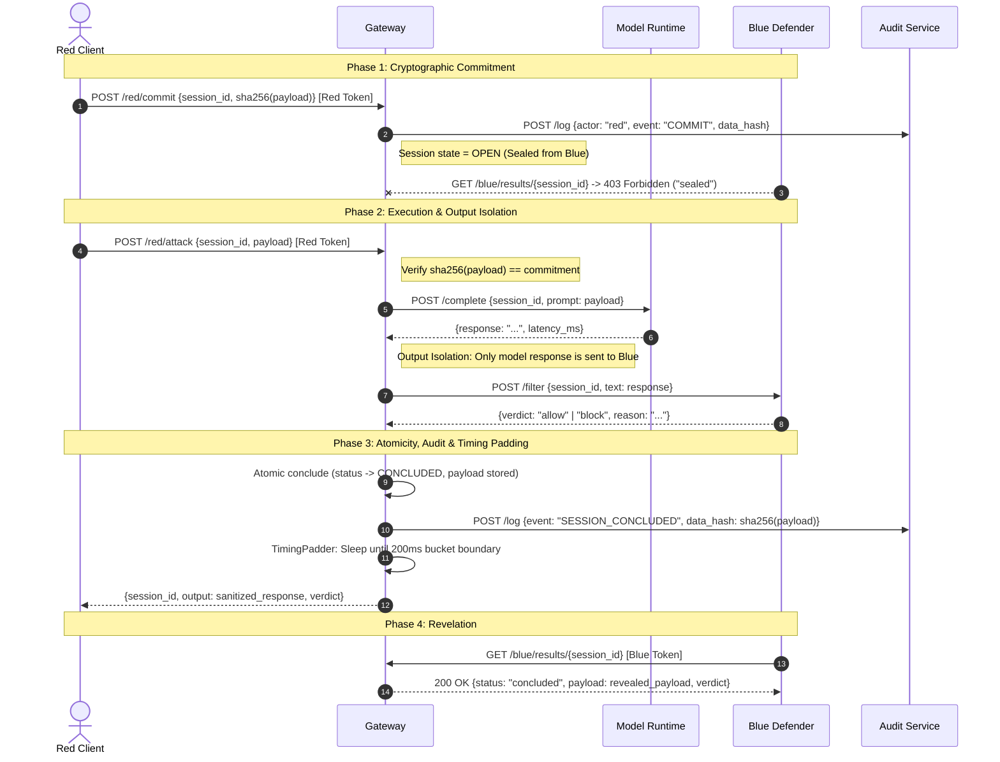

# Bayora Vault — System Architecture

> **Proof of Concept: Secure Adversarial AI Safety Testing Infrastructure**  
> Hack in Hills '26 — Problem #04 (Bayora)

---

## 1. Architectural Overview

Bayora Vault provides secure, multi-tenant containerized infrastructure for adversarial AI red/blue testing on a single Docker host without information leakage. 

A Red team (attacker), Blue team (defender), client LLM, and Audit service run concurrently with strict cryptographic isolation, capability-based access control, response-time padding, and tamper-evident append-only logging.



---

## 2. Network Topology & Routing Isolation

The Docker Compose configuration isolates components across five distinct virtual bridges:

| Network | Type | Attached Containers | Isolation Guarantee |
|---|---|---|---|
| `red_net` | `internal: true` | `red`, `gateway` | Red has **no** route to Blue, LLM, Audit, or external internet. |
| `blue_net` | `internal: true` | `blue`, `gateway` | Blue has **no** route to Red, LLM, Audit, or external internet. |
| `model_net` | `internal: true` | `llm`, `gateway` | Model is shielded from direct Red/Blue access; reachable only via Gateway. |
| `audit_net` | `internal: true` | `audit`, `gateway`, `dashboard` | Audit log service is shielded from untrusted Red/Blue containers. |
| `front` | `internal: false` | `dashboard` | The **only** network publishing an external host port (`8080:8080`). |

> [!IMPORTANT]
> **Disjoint Network Invariant:** Red and Blue share **zero** common networks. Packet traversal, ARP resolution, and TCP handshakes directly between Red and Blue are rejected at the kernel bridge level.

---

## 3. Cryptographic Commit-Reveal Protocol

To ensure fair, leak-free evaluations, Red payloads are withheld from Blue until after defense evaluation has concluded:



---

## 4. Capability Token Architecture

All API endpoints enforce HMAC-SHA256 capability tokens (`services/gateway/tokens.py`):

$$\text{Token} = \text{base64url}(\text{header}) \mathbin{\Vert} \text{base64url}(\text{payload}) \mathbin{\Vert} \text{base64url}(\text{HMAC-SHA256}(K, \text{header} \mathbin{\Vert} \text{payload}))$$

* **Claims**: `{"role": "red" | "blue", "session_id": "<sid>", "exp": <unix_ts>}`
* **Role Separation**: A token issued for role `red` is rejected with `HTTP 403 Forbidden` if used on Blue endpoints, and vice-versa.
* **Per-Session Binding**: Tokens are bound to an explicit `session_id`.

---

## 5. Tamper-Evident Audit Log Chain

The `audit` service maintains an immutable, append-only Merkle-like hash chain signed with an asymmetric Ed25519 key:

$$\text{hash}_i = \text{SHA-256}\left(\text{prev\_hash}_{i} \mathbin{\Vert} \text{canonical\_json}(\text{payload}_i)\right)$$

$$\text{signature}_i = \text{Ed25519}_{\text{priv\_key}}(\text{hash}_i)$$

Where $\text{payload}_i$ comprises:
```json
{
  "seq": 1,
  "ts": "2026-10-25T15:10:00Z",
  "actor": "gateway",
  "event": "SESSION_CONCLUDED verdict=allow",
  "data_hash": "e3b0c44298fc1c149afbf4c8996fb92427ae41e4649b934ca495991b7852b855",
  "prev_hash": "cfea2f573c315d66b9706b72cadfde89fde0bfff38e344bcaabbed099d9ee37a"
}
```

* **Zero-Leakage Observability**: Sensitive payload text is **never** written to audit entries or log stdout. Only the SHA-256 hash of sensitive data is preserved.
* **Offline Verification**: `scripts/verify.py` reconstructs the entire hash chain from an exported JSON file and verifies every Ed25519 signature against `ed25519_public.pem`. Modifying even a single bit in any historical entry invalidates the chain.

---

## 6. Container Hardening Specification

Every container in the cluster enforces defence-in-depth kernel hardening (`docker-compose.yml`):

1. **Non-Root Execution**: Every service creates and runs as an unprivileged user (`audit`, `gateway`, `red`, `blue`, `llm`, `dashboard`).
2. **Read-Only Root Filesystem**: `read_only: true` prevents writing to system binaries or libraries. Ephemeral writes are restricted to memory-backed `tmpfs: [/tmp]`.
3. **Capability Stripping**: `cap_drop: [ALL]` removes all Linux capabilities, preventing privilege escalation.
4. **No New Privileges**: `security_opt: [no-new-privileges:true]` blocks `setuid`/`setgid` execution.
5. **Seccomp System Call Filtering**: `security/seccomp.json` enforces a strict system-call whitelist, blocking raw socket creation, ptrace, and namespace modifications.
6. **Resource Limits**: `pids_limit: 50`, `mem_limit: 256m`, and `cpus: "0.5"` protect against denial-of-service and fork bombs.

---

## 7. Model Interface & Ollama Profile (Dual-Model Architecture)

The system exposes a single, uniform model interface behind the mediation gateway:
* **Contract**: `POST /complete` with `{ session_id: str, prompt: str }` returning `{ session_id: str, response: str, latency_ms: float }`.
* **MockLLM (Default Profile)**:
  * Deterministic mock response engine with simulated prompt-proportional latency ($\approx 1.0\text{ ms/char}$).
  * Used for deterministic automated regression and timing probe verification.
* **Ollama Real Model Profile (`--profile ollama`)**:
  * Employs open-source **SmolLM 135M** (`smollm:135m`), a lightweight high-performance small language model (~270MB).
  * Runs on CPU inside the isolated `model_net` bridge with no external network route.
  * An automated `ollama-pull` container downloads and registers the model upon profile startup.
  * **Stateless Enforcement**: The adapter makes stateless calls to Ollama's `/api/generate` endpoint without forwarding prior context vectors and with `keep_alive: 0`, guaranteeing zero cross-session KV-cache contamination or prompt leakage.
  * Start command: `make up-ollama` or `LLM_BACKEND=ollama docker compose --profile ollama up -d --build`.

